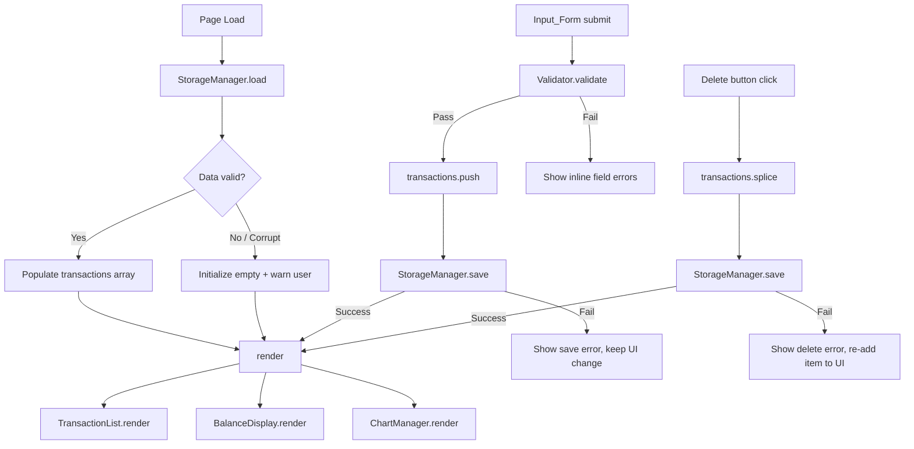
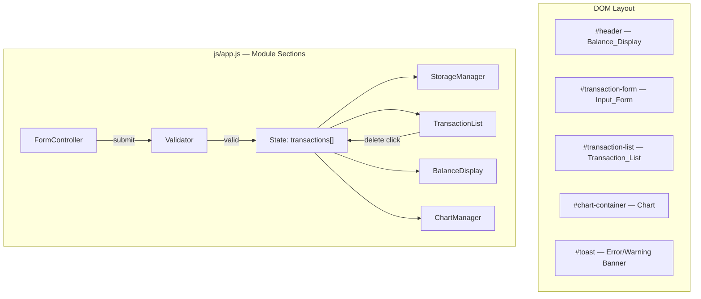

# Design Document

## Overview

The Expense & Budget Visualizer is a fully client-side, single-page web application implemented with HTML, CSS, and Vanilla JavaScript. It allows users to record personal expenses by name, amount, and category; view a running total balance; browse a scrollable transaction history; and inspect spending distribution via a pie chart. All data is persisted in the browser's LocalStorage so records survive page refreshes and browser restarts. No server, build tool, or package manager is required — the app opens directly from the file system or runs as a browser extension.

The design follows a **single-file, module-free architecture**: one HTML entry point (`index.html`), one stylesheet (`css/styles.css`), and one JavaScript file (`js/app.js`). External code is limited to [Chart.js](https://www.chartjs.org/) loaded via CDN for the pie chart.

---

## Architecture

### High-Level Structure

```
index.html          ← entry point, loads Chart.js CDN + css/styles.css + js/app.js
css/
  styles.css        ← all styling
js/
  app.js            ← all application logic
```

### Runtime Architecture

The application is event-driven with a single source of truth: an in-memory array of transaction objects that is kept in sync with LocalStorage at every mutation.



### Key Design Decisions

| Decision | Choice | Rationale |
|---|---|---|
| State management | Single in-memory `transactions` array | Simple and sufficient for the scale; avoids framework overhead |
| Rendering model | Full re-render on each mutation | Keeps rendering logic simple; transaction counts are small |
| Storage key | Fixed string `"expense_budget_visualizer_v1"` | Stable across sessions; versioned to allow future migrations |
| Chart library | Chart.js 4.x via jsDelivr CDN | Mature, well-documented, zero install, pie chart support |
| Error display | Inline field errors + toast-style non-blocking banners | Separates validation feedback (inline) from storage/CDN errors (banner) |

---

## Components and Interfaces

### Component Overview



### StorageManager

Encapsulates all LocalStorage interactions.

```
StorageManager.save(transactions)
  - JSON.stringify(transactions)
  - localStorage.setItem(STORAGE_KEY, json)
  - throws StorageError on failure

StorageManager.load()
  - raw = localStorage.getItem(STORAGE_KEY)
  - if null → return []
  - JSON.parse(raw) → validate each entry → return valid[]
  - on SyntaxError → throw ParseError
  - on invalid schema → filter, throw SchemaWarning

StorageManager.isAvailable()
  - probe write/read/delete
  - return boolean
```

### Validator

Pure functions that inspect form field values and return a result object.

```
Validator.validate(name, amount, category)
  → { valid: boolean, errors: { name?: string, amount?: string } }

Validator.isValidAmount(value)
  → boolean  (0.01 ≤ value ≤ 999_999_999.99, numeric)

Validator.isValidName(value)
  → boolean  (non-empty, ≤ 100 chars after trim)
```

### FormController

Owns the `<form>` DOM node. Binds the `submit` event, reads field values, calls `Validator`, displays inline errors, and—on success—appends to `transactions`, calls `StorageManager.save`, then triggers a full render. On storage failure it shows a toast but keeps the in-memory change.

### TransactionList

```
TransactionList.render(transactions)
  - clears #transaction-list
  - if empty → show placeholder message
  - else → for each tx, create <li> with name, formatted amount, category, delete button

TransactionList.onDelete(id)   [event delegation on #transaction-list]
  - splice tx from transactions by id
  - StorageManager.save(transactions) — on fail show toast, re-insert
  - render()
```

### BalanceDisplay

```
BalanceDisplay.render(transactions)
  - sum = transactions.reduce((acc, tx) => acc + tx.amount, 0)
  - format sum as currency string (e.g. "$1,234.56")
  - update #balance text node
```

### ChartManager

```
ChartManager.init()
  - check window.Chart exists (CDN loaded)
  - if not → show fallback message in #chart-container, set chartAvailable = false
  - else → new Chart(ctx, { type: 'pie', ... }), set chartAvailable = true

ChartManager.render(transactions)
  - if !chartAvailable → return
  - compute totals per category
  - if all totals === 0 → show placeholder text, hide canvas
  - else → show canvas, update chart.data.datasets[0].data + chart.data.labels, chart.update()
```

### Toast / Banner

```
showToast(message, type)   // type: 'error' | 'warning'
  - set #toast text + CSS class
  - make visible
  - auto-hide after 5 seconds
```

---

## Data Models

### Transaction Object

```javascript
{
  id:       string,   // crypto.randomUUID() or Date.now().toString() fallback
  name:     string,   // 1–100 chars, trimmed
  amount:   number,   // 0.01–999,999,999.99, stored as float
  category: string    // "Food" | "Transport" | "Fun"
}
```

### Storage Schema

```
Key:   "expense_budget_visualizer_v1"
Value: JSON string — array of Transaction objects

Example:
[
  { "id": "abc123", "name": "Lunch", "amount": 12.50, "category": "Food" },
  { "id": "def456", "name": "Bus pass", "amount": 45.00, "category": "Transport" }
]
```

### Validation Rules

| Field | Rule |
|---|---|
| `name` | Required; trimmed length 1–100 characters |
| `amount` | Required; numeric; 0.01 ≤ value ≤ 999,999,999.99 |
| `category` | Required; one of `["Food", "Transport", "Fun"]` |

### Category Aggregation (for Chart)

```javascript
// Computed on-the-fly, not stored
const totals = { Food: 0, Transport: 0, Fun: 0 };
transactions.forEach(tx => totals[tx.category] += tx.amount);
// Filter out zero-value categories before passing to Chart.js
```

---

## Correctness Properties

*A property is a characteristic or behavior that should hold true across all valid executions of a system — essentially, a formal statement about what the system should do. Properties serve as the bridge between human-readable specifications and machine-verifiable correctness guarantees.*

### Property 1: Transaction serialization round-trip

*For any* array of well-formed Transaction objects, serializing it to JSON via `StorageManager.save` and immediately deserializing it via `StorageManager.load` should produce an equivalent array — same length, same `id`, `name`, `amount`, and `category` values on every entry.

**Validates: Requirements 5.1, 5.2, 5.3**

---

### Property 2: Whitespace and empty names are always rejected

*For any* string composed entirely of whitespace characters (spaces, tabs, newlines) or the empty string, submitting it as an item name should be rejected by the Validator, the transaction list should remain unchanged (length unchanged, no new entry added), and no write to Storage should occur.

**Validates: Requirements 1.3**

---

### Property 3: Out-of-range and non-numeric amounts are always rejected

*For any* value that is zero, strictly negative, strictly greater than 999,999,999.99, or not a valid finite number (NaN, Infinity, non-numeric string), submitting it as the amount should be rejected by the Validator, the transaction list should remain unchanged, and no write to Storage should occur.

**Validates: Requirements 1.4**

---

### Property 4: Balance equals the arithmetic sum of all transaction amounts

*For any* array of transactions (including the empty array), the value displayed by `BalanceDisplay` should equal the arithmetic sum of all transaction `amount` fields, and the result should be formatted with a currency symbol (`$`) and exactly two decimal places (e.g., `$0.00`, `$1,234.56`).

**Validates: Requirements 3.1, 3.4**

---

### Property 5: Pie chart data reflects proportional category totals

*For any* non-empty transaction array, the data passed to Chart.js for each segment should equal that category's total amount divided by the sum of all amounts; only categories whose total is strictly greater than zero should appear as segments; and the segments' values should sum to the total of all transaction amounts.

**Validates: Requirements 4.1, 4.4**

---

### Property 6: Deleting a transaction reduces the list by exactly one and updates all displays

*For any* transaction array of length N ≥ 1, deleting any single transaction at any valid index should produce a transaction list of length N − 1 that does not contain the deleted entry; `BalanceDisplay` should reflect the recalculated sum; and the chart data should reflect the revised category totals.

**Validates: Requirements 2.3, 3.3, 4.3**

---

### Property 7: Form resets to its initial state after every successful submission

*For any* valid (name, amount, category) tuple, after a successful form submission the item name field value should be the empty string, the amount field value should be the empty string, and the category dropdown's selected value should be `"Food"`.

**Validates: Requirements 1.5**

---

### Property 8: Malformed storage entries are silently filtered; well-formed entries are preserved

*For any* array mixing well-formed and structurally invalid Transaction objects (missing required fields, wrong field types), `StorageManager.load` should return only the well-formed entries in the same order, with no mutation of their field values, and should discard all invalid entries without throwing.

**Validates: Requirements 5.5**

---

## Error Handling

### Error Categories and Responses

| Scenario | Detection | User Feedback | App Behavior |
|---|---|---|---|
| Empty required field | Validator (pre-submit) | Inline message next to field | Prevent save |
| Invalid amount | Validator (pre-submit) | Inline message next to amount field | Prevent save |
| LocalStorage unavailable on load | `StorageManager.isAvailable()` | Toast warning | Initialize with empty list |
| Corrupt JSON in Storage | `JSON.parse` SyntaxError | Toast warning | Initialize with empty list |
| Partial schema violations | Per-field validation on parse | Toast warning | Initialize with valid entries only |
| LocalStorage write failure (add) | `try/catch` on `setItem` | Toast error | Keep in-memory change, reflect in UI |
| LocalStorage write failure (delete) | `try/catch` on `setItem` | Toast error | Re-insert tx into list, discard in-memory splice |
| Chart.js CDN fails to load | `window.Chart === undefined` | Static message in chart container | All other features work normally |

### Error Display Strategy

- **Inline validation errors**: positioned immediately below each invalid field; cleared on the next successful submission or when the user corrects the field.
- **Toast banners**: positioned at the bottom of the viewport; auto-dismiss after 5 seconds; `role="alert"` for screen reader accessibility; color-coded (red for errors, amber for warnings).

---

## Testing Strategy

### Unit Tests

Unit tests cover deterministic, pure-function behavior:

- **Validator**: `isValidName` and `isValidAmount` with boundary values (empty string, all-whitespace, length 100, length 101, amount 0, 0.01, 999_999_999.99, 1_000_000_000, NaN, negative).
- **StorageManager.load**: mock `localStorage.getItem` to return valid JSON, corrupt JSON, null, and partially invalid entries.
- **BalanceDisplay formatting**: verify currency format for $0.00, $1.00, $1,234.56, large values.
- **Category aggregation**: verify totals map for empty array, single category, all three categories, and transactions summing to zero in a category.

### Property-Based Tests

Property-based tests use a PBT library (e.g., [fast-check](https://github.com/dubzzz/fast-check)) to verify universal invariants across randomly generated inputs. Each test runs a minimum of 100 iterations.

Each test is tagged with:
> `Feature: expense-budget-visualizer, Property {N}: {property_text}`

| Test | Property Reference | Generator Inputs |
|---|---|---|
| Serialization round-trip | Property 1 | Random arrays of valid Transaction objects |
| Whitespace name rejection | Property 2 | Strings of whitespace chars (`' '`, `'\t'`, `'\n'`, empty) |
| Invalid amount rejection | Property 3 | Numbers outside [0.01, 999_999_999.99], zero, negatives, NaN |
| Balance equals sum | Property 4 | Random arrays of valid Transaction objects (including empty) |
| Chart proportions | Property 5 | Random transactions across 1–3 categories |
| Delete reduces list by 1 | Property 6 | Random list (length ≥ 1) + random index to delete |
| Form reset after submit | Property 7 | Random valid (name, amount, category) triples |
| Malformed entries filtered | Property 8 | Mixed arrays of valid and structurally invalid entries |

### Integration Tests

Integration tests verify UI wiring and storage with realistic scenarios:

- Full add → persist → reload → restore flow (actual `localStorage` calls).
- Full add → delete → reload → verify entry absent flow.
- CDN failure path: unset `window.Chart` and verify fallback message renders without crashing.
- Storage unavailable: mock `localStorage.setItem` to throw and verify toast appears.

### Browser Compatibility

Manual smoke tests in Chrome, Firefox, Edge, and Safari should verify:

- LocalStorage reads/writes function correctly.
- Chart.js pie chart renders.
- Form submission and delete interactions work.
- Layout and typography render at ≥14px and pass visual hierarchy checks.
